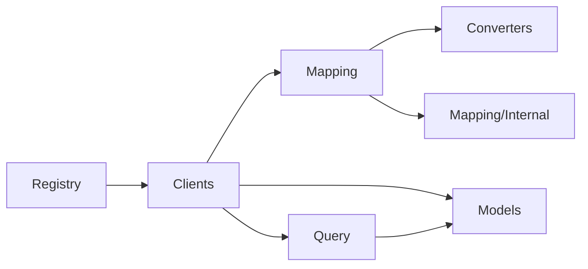

# AzureTableUtils — Projektstruktur

Physische Ordner spiegeln Verantwortlichkeiten; **öffentliche Typen bleiben in den bestehenden Namespaces** (`WebGate.Azure.TableUtils`, `.Models`, `.Converter`), damit Consumer (NuGet) ohne Anpassung weiterbauen.

## Produktion (`AzureTableUtils/`)

| Ordner | Inhalt | Namespace |
|--------|--------|-----------|
| `Clients/` | `TypedAzureTableClient`, `MultiEntityAzureTableClient` | `WebGate.Azure.TableUtils` |
| `Registry/` | `ExtendedAzureTableClientService` | `WebGate.Azure.TableUtils` |
| `Query/` | OData: `TableFilter`, `TableQueryBatch`, `TableQueryTopSelect`, `TableRowKeys`, `TableDateTime`, … | `WebGate.Azure.TableUtils` |
| `Mapping/` | `ObjectSerializer`, `ObjectBuilder` | `WebGate.Azure.TableUtils` |
| `Mapping/Internal/` | `EntityMapping` (internal) | `WebGate.Azure.TableUtils` |
| `Converters/` | Typ-Konverter für Serialize/Build | `WebGate.Azure.TableUtils.Converter` |
| `Models/` | `TableEntityResult` (Dateiname historisch `TabelEntityResult.cs`) | `WebGate.Azure.TableUtils.Models` |

Projekt-Root: nur `AzureTableUtils.csproj` und die Ordner oben (kein Mixed Layout; keine `GlobalUsings.cs`).

### Abhängigkeiten zwischen Modulen

- **Clients** rufen **Mapping** beim (De-)Serialisieren auf und **Query** für Filter/Helfer.
- **Registry** erzeugt SDK-`TableClient`-Instanzen und registriert **Clients**.
- **Converters** sind nur über **Mapping** sichtbar (public, aber selten direkt importiert).

## Dokumentation

- **README:** Nutzerhandbuch, Beispiele, Release Notes.
- **XML (`///`):** alle public (und internal Kern-) APIs im Projekt; NuGet liefert `AzureTableUtils.xml` für IntelliSense.
- **Tests:** spiegeln `Query/`, `Mapping/`, `Fixtures/` — keine API-Docs nötig.

## Tests

| Projekt | Ordner | Namespace |
|---------|--------|-----------|
| `AzureTableUtils.Tests` | `Query/`, `Mapping/`, `Fixtures/` | `WebGate.Azure.TableUtils.Tests`, `.Tests.Fixtures` |
| `AzureTableUtils.IntegrationTests` | `Crud/`, `MultiEntity/`, `LargeDataset/` | `WebGate.Azure.TableUtils.IntegrationTests` |

## Versionierung

| Änderung | Version |
|----------|---------|
| Ordner-/Test-Refactor, Docs, XML | Patch (z. B. 10.1.3) |
| Neue Query-APIs ohne Namespace-Break | Minor/Patch |
| Namespace-Aufteilung, `TableEntityResult`-Rename-Datei | Major (11.x) |
